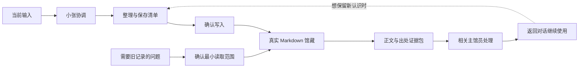

# Cognitive Museum · 认知博物馆

**一个由 AI 辅助迭代的个人知识工作流：让记录被保存，也让真实旧记录在需要时回到对话。**

[English](README.en.md) · [快速开始](docs/quickstart.md) · [作品集案例](docs/portfolio-case-study.md) · [架构](docs/architecture.md) · [匿名演示](examples/README.md)

认知博物馆采用 Obsidian 兼容的 Markdown 文件组织个人记录，由“小张”协调十四种馆员角色。回顾、讨论、写作与自我反思依赖旧材料时，先取得读取范围授权，实际读取笔记，提取可定位的证据，再交由合适角色处理。

## 解决的问题

个人外脑很容易持续接收新输入。使用旧记录时，则需要另一条完整链路：判断什么时候检索，找到真实文件，保留原始语境，把证据带回正在进行的讨论。

本项目将入馆与馆藏使用分别定义，使查询可以在对话中完成，而保存仍由使用者决定。

## 工作流

## 已实现的内容

- **自然语言入口：** 小张判断当前需要，使用者不必选择馆员。
- **十四种角色规则：** 捕获、研究、生活、连接、写作、回顾、模式和维护各有职责与停止条件。
- **真实馆藏取证规范：** 查询范围、候选发现、正文核对、来源定位、反例与覆盖限制。
- **三个请求类型：** `vault_query_request`、`vault_review_request`、`maintenance_request`。
- **分开的完成状态：** 已取证、已回传与文件 `saved` 各有证据要求。
- **可移植骨架：** Vault 导航、笔记模板、独立 Prompt、项目说明与合并参考。

实现载体是 Markdown 规则、Prompt 与模板。执行检索需要运行环境提供文件工具；跨聊天派发和回传还需要相应工具与直接用户授权。十四种角色是按任务选择的工作模式，通常每次使用一位主馆员。

## 看一个例子

> “这两次记录里，我的工作方式有什么不同？”

小张读取获准的两份笔记，把原话、日期和位置交给相应馆员，比较差异并说明材料限制。结果可以只用于此次讨论。

[匿名演示](examples/README.md) 提供完全虚构的两份记录、查询请求、证据包和示范答复。它不包含作者的日记或实际经历。

## 快速开始

1. 下载仓库，将 `vault-template/` 复制到自己的新 Vault 或作为逐项参考；先保留已有文件，不覆盖个人馆藏。
2. 配置自己的 `${VAULT_ROOT}`；需要项目参考时使用 `config/` 与 `project-reference/`。
3. 在具有本地文件读取能力的 AI 环境中加载小张规则。
4. 直接提出需要，例如“帮我回顾这个时间段”“找找以前关于这个问题的记录”。范围不明确时先确认。

详细步骤见 [快速开始](docs/quickstart.md)。

## 仓库结构

| 位置 | 内容 |
|---|---|
| `vault-template/` | 可移植的馆藏结构、规则、十四位馆员和空白模板 |
| `config/` | 可复制的 AI 项目说明与环境配置说明 |
| `project-reference/` | 供项目环境读取的合并规则参考 |
| `examples/` | 完全虚构的请求、记录、证据与输出 |
| `docs/` | 使用方法、架构、设计决策与验证范围 |

## 验证范围

在原使用环境中，已核对 22 份系统文件的实际更新与重新读取，检查十四份角色 Prompt 和合并参考的一致性，并从一份真实落地的流程测试记录提取原文和行号。项目参考上传后也已通过下载副本逐字节核对。

这些检查支持规则部署和真实文件读取。自动跨聊天往返、手机同步，以及不同主机上的完整周期复盘，仍需要在相应运行环境中单独验收。[详细说明](docs/verification.md)

## AI 辅助开发方式

人负责定义需求、使用体验、证据边界和最终取舍；AI 协助检查现有文件、提出机制、修改规则与核验产物。关键迭代是从“输入与保存”扩展到“真实取证与返回讨论”。

本仓库公开的是系统设计与匿名骨架。个人日记、生活记录、真实交接账本、私人附件和本机配置保存在各自的私人 Vault 中。
