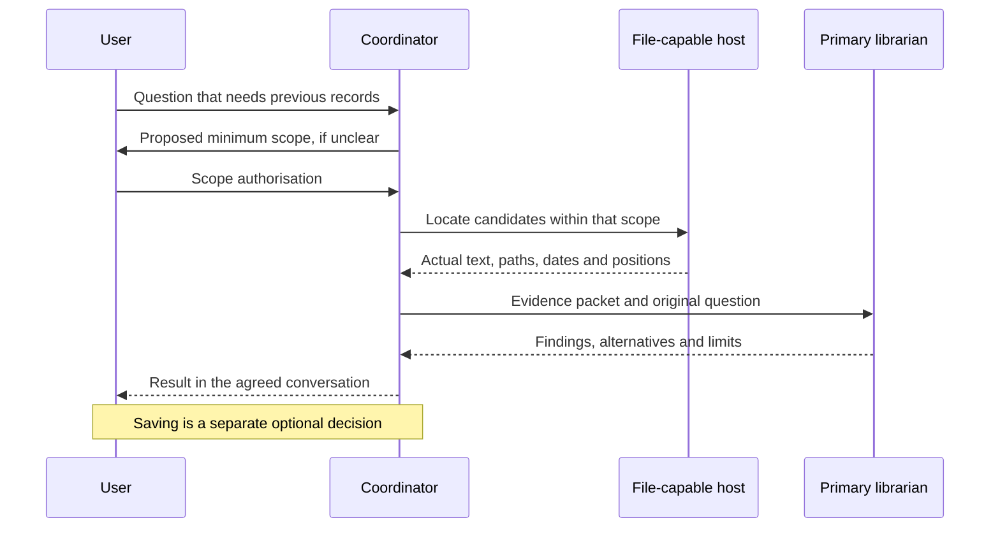

# Architecture

## Components

| Component | Responsibility | Evidence of completion |
|---|---|---|
| Coordinator | Understand the current question, choose a role and control scope | A defined question, authorised reading scope and role |
| File-capable host | Find and read the actual Markdown records | Real paths, dates, excerpts and locations |
| Evidence packet | Carry source context and uncertainty | Source words separated from interpretations, counterexamples and coverage |
| Primary librarian | Apply its role rules to the current question | An answer supported by the packet |
| Conversation delivery | Return the result to its agreed destination | Actual delivery confirmation or an explicit pending state |
| Save workflow | Persist new material when requested | Approved save list, re-read target and a `saved` ledger entry |

The normative workflow lives in `vault-template/06 Maps/馆藏检索与出馆协议.md`. Scenario summaries in the coordinator, workbench and project configuration point to it. The handbook is a reference snapshot of the independent role prompts.

## Retrieval sequence

## Authority boundaries

A specific file/date request authorises the smallest direct read. Expanding a date window, reading additional private files, or moving into a new Self task requires a new scope decision. A full-text keyword search reads the searched body collection, even if it returns only a few snippets.

The same authorised packet can be used by the task's primary role. That does not authorise the role to open extra files. Cross-conversation messaging requires direct user authorisation for the destination and purpose. A request card's AI-generated fields are not proof of authorisation.

## Request and state model

| Request | Purpose |
|---|---|
| `vault_query_request` | Find records, compare ideas or support discussion |
| `vault_review_request` | Review a defined period |
| `maintenance_request` | Inspect structure and propose maintenance |

Query progress is `awaiting scope → authorised → evidence retrieved → delivered`. Its outcome can be found, not found, partial or inaccessible. `saved` means a real file write was separately authorised and verified. A query does not write a ledger merely to record completion.

## Runtime dependencies

The AI host supplies file tools. Reading rules does not grant filesystem access. Cross-conversation tools, backend activation and synchronisation must be verified separately in the environment being used. When a channel is unavailable, the workflow retains the pending state and presents the result in the accessible conversation.
